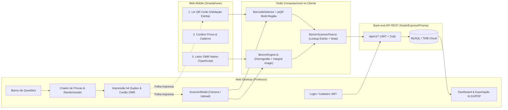
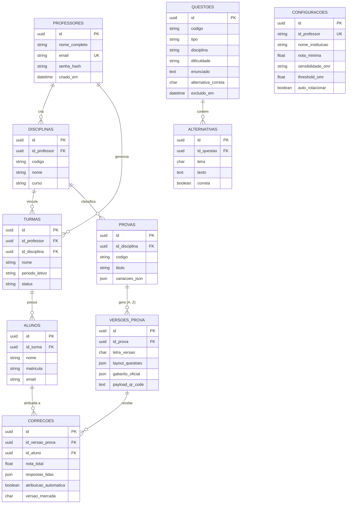

# Documentação Técnica — SGP / Correge

**Sistema de Geração, Randomização e Correção Automática de Provas via QR Code e Leitura Óptica (OMR)**  
*Centro Universitário Católica de Santa Catarina (Católica SC)*

---

## Sumário

1. [Visão Geral da Arquitetura](#1-visão-geral-da-arquitetura)
2. [Stack Tecnológica](#2-stack-tecnológica)
3. [Estrutura do Projeto](#3-estrutura-do-projeto)
4. [Modelo de Dados (MER / DER)](#4-modelo-de-dados-mer--der)
5. [Autenticação Real (JWT + bcrypt) e Conformidade LGPD](#5-autenticação-real-jwt--bcrypt-e-conformidade-lgpd)
6. [Motor de Randomização e Impressão A4 Duplex](#6-motor-de-randomização-e-impressão-a4-duplex)
7. [Especificação do QR Code e Motor Óptico OMR Nativo (TypeScript)](#7-especificação-do-qr-code-e-motor-óptico-omr-nativo-typescript)
8. [Contratos da API REST](#8-contratos-da-api-rest)
9. [Detecção Mobile vs. Modo de Impressão A4](#9-detecção-mobile-vs-modo-de-impressão-a4)
10. [Instalação, Testes e Execução](#10-instalação-testes-e-execução)

---

## 1. Visão Geral da Arquitetura

O **Correge (SGP)** é composto por dois serviços independentes que operam **100% sobre dados reais em banco relacional (MySQL / TiDB Cloud)**, sem repositórios *mock* ou dados simulados:

1. **Front-end Web Desktop & Mobile (`front-end/`)**: aplicação Next.js 16 (App Router) que entrega o painel completo para gestão pedagógica, criação de provas e impressão A4 no Desktop, e a interface dedicada de câmera nativa no Smartphone (`MobileScannerScreen`) — além do modal de leitura ao vivo e upload no Desktop (`ScannerModal`).
2. **Back-end REST API (`back-end/`)**: servidor Node.js + Express + TypeScript em arquitetura hexagonal com repositórios Prisma ORM, autenticação Bearer JWT + `bcryptjs`, geração de PDFs A4 via PDFKit, importação/exportação Excel via ExcelJS e validação anti-fraude de QR Codes via SHA-256.



---

## 2. Stack Tecnológica

| Camada | Tecnologias |
|---|---|
| **Front-end Web & Mobile** | Next.js 16 (App Router / Turbopack), React 19, TypeScript 5, Tailwind CSS 4, Lucide Icons |
| **Motor Óptico OMR & QR Code** | TypeScript puro (`lib/omrEngine.ts`, `lib/omrScannerFlow.ts`), `jsqr`, `BarcodeDetector API`, `qrcode` |
| **Back-end API REST** | Node.js 20+, Express 4, TypeScript 5, Prisma ORM 6, Zod, PDFKit, ExcelJS |
| **Segurança** | `bcryptjs` (cost 10), `jsonwebtoken` (Bearer JWT), rate limiter em janela deslizante |
| **Banco de Dados** | MySQL / TiDB Cloud (`prisma/schema.prisma`) |

---

## 3. Estrutura do Projeto

```text
Correge/
├── back-end/
│   ├── api/index.ts                  # Entrypoint Vercel Serverless
│   ├── prisma/schema.prisma          # 10 modelos relacionais (MySQL / TiDB)
│   ├── src/
│   │   ├── config/database.ts        # Singleton Prisma Client
│   │   ├── controllers/              # Controladores HTTP REST
│   │   ├── middlewares/              # authMiddleware (JWT + Rate Limit), errorHandler
│   │   ├── repositories/
│   │   │   ├── interfaces/           # Ports (IProfessorRepository, IExamRepository, etc.)
│   │   │   └── prisma/               # Adapters exclusivos Prisma ORM (zero mocks)
│   │   ├── routes/                   # Rotas /api/v1/*
│   │   ├── services/                 # Variações, PDF A4, QR SHA-256, Relatórios
│   │   ├── app.ts                    # Aplicação Express
│   │   └── server.ts                 # Servidor HTTP (porta padrão 3001)
│   └── tests/                        # Suítes unitárias, integração e relatórios
└── front-end/
    ├── app/                          # Rotas App Router (/provas, /banco-questoes, /resultados, /print-render...)
    │   └── api/omr/route.ts          # Endpoint auxiliar de correção determinística (sem fallback falso)
    ├── components/
    │   ├── auth/                     # LoginScreen, RegisterScreen, PasswordRecoveryScreen
    │   ├── common/                   # A4ExamSheet, A4AnswerSheet, QrCodeGraphic, CorregeLogo
    │   ├── layout/                   # AppShell (Desktop/Mobile/Print + loading de sessão), Header, Sidebar
    │   ├── modals/                   # ScannerModal (OMR real), NewQuestionModal, NewStudentModal, ExcelImportModal
    │   └── screens/                  # Telas principais + MobileScannerScreen (OMR real)
    ├── context/AppContext.tsx        # Sessão JWT verificada e sincronização real com API REST
    ├── docs/                         # Documentação técnica, manual do usuário e diagramas UML
    ├── lib/
    │   ├── api.ts                    # Cliente HTTP com injeção automática de Authorization Bearer
    │   ├── omrEngine.ts              # Motor de visão computacional OMR em TypeScript puro
    │   ├── omrScannerFlow.ts         # Validação estrita de QR, busca exata de prova e nota determinística
    │   ├── qrCode.ts                 # Gerador SVG ISO/IEC 18004 e parser de payloads
    │   └── types.ts                  # Contratos TypeScript de domínio
    └── tests/                        # Testes unitários (OMR sintético, lookup estrito, impressão, relatórios)
```

---

## 4. Modelo de Dados (MER / DER)

Espelha fielmente o schema `back-end/prisma/schema.prisma`:



---

## 5. Autenticação Real (JWT + bcrypt) e Conformidade LGPD

- **Domínio institucional obrigatório**: apenas endereços `@catolicasc.org.br` são aceitos para cadastro e login docente.
- **Armazenamento seguro de credenciais**: senhas (mínimo 8 caracteres) são armazenadas exclusivamente como hash `bcrypt` (`$2a$` / `$2b$` / `$2y$`). Nenhuma senha em texto puro é aceita ou persistida.
- **Sessão JWT verificada**:
  1. `POST /api/v1/professores/login` e `POST /api/v1/professores` retornam token JWT assinado (`Authorization: Bearer <token>`).
  2. O front-end persiste `{ token, user }` em `localStorage['correge_auth_session']` e injeta o cabeçalho `Authorization` automaticamente em todas as requisições (`lib/api.ts`).
  3. Ao recarregar a página, o `AppProvider` valida a expiração `exp` do JWT e consulta `GET /api/v1/professores/me` (com retrocompatibilidade para `/professores/:id`), exibindo estado de carregamento no `AppShell` e invalidando sessões expiradas/revogadas.
- **Proteção contra força bruta**: `createAuthRateLimiter` limita tentativas por par IP + e-mail em janela deslizante (HTTP 429).
- **Alteração autenticada de senha**: `PUT /api/v1/professores/me/password` (disponível na tela `/configuracoes`) exige validação da senha atual via `bcrypt.compare`.
- **Recuperação de senha**: `POST /api/v1/professores/forgot-password` exige configuração SMTP real (retorna HTTP 503 `SMTP_NOT_CONFIGURED` caso ausente — sem vazar códigos demonstrativos na interface); `POST /api/v1/professores/reset-password` valida token JWT assinado com `JWT_SECRET + senhaHashAtual`, garantindo invalidação automática após uso único.
- **Anonimização LGPD**: `POST /api/v1/professores/me/anonymize` substitui nome por `"Usuário Removido"`, e-mail por `anon-<id>@removido.local`, trava a senha no banco e preserva integralmente provas, turmas e notas acadêmicas.

---

## 6. Motor de Randomização e Impressão A4 Duplex

### 6.1 Permutação de Questões e Alternativas (Cadernos A–Z)
- Suporta de **1 até 26 cadernos** (`A` até `Z`) via *Fisher-Yates* ou *Rotação Cíclica*.
- Rastreia o texto da alternativa correta antes da permutação para reconstruir o `answerKey` oficial de cada caderno e sincroniza automaticamente as linhas na tabela `versoes_prova`.

### 6.2 Impressão A4, Compensação Duplex e Paridade PDF
Nos componentes `components/common/A4ExamSheet.tsx` e `components/common/A4AnswerSheet.tsx`:
- **Calibração 100%**: regra `@page { size: A4 portrait; margin: 0; }` em `app/globals.css`.
- **Compensação Duplex**: quando o modo Frente e Verso está ativo e o caderno de questões termina em página ímpar, `A4BlankVersoSheet` insere verso em branco automático para que o Cartão-Resposta OMR seja impresso sempre em folha destacável isolada.
- **4 Marcadores Fiduciais**: quadrados pretos de alto contraste nos quatro cantos com marcador assimétrico no canto superior esquerdo e *Quiet Zone* de 5 mm ao redor do QR Code.
- **Paridade de Exportação**: rota headless `/print-render` e geração binária PDFKit no back-end (`/api/v1/exams/:id/download-pdf` e `/answer-sheet/pdf`).

---

## 7. Especificação do QR Code e Motor Óptico OMR Nativo (TypeScript)

### 7.1 Formatos de Payload QR Code Aceitos (Validação Estrita)
A função `validateCorregeQrRaw` (`front-end/lib/omrScannerFlow.ts`) aceita exclusivamente payloads JSON institucionais do Correge e **rejeita** URLs arbitrárias, códigos Pix ou textos genéricos:

1. **Cartão-Resposta OMR (`A4AnswerSheet.tsx`)**:
   ```json
   {
     "app": "CORREGE",
     "examId": "uuid-da-prova",
     "code": "#DIR-4561",
     "exam": "DIR4561",
     "ver": "A",
     "nominal": true,
     "std": "2026.1.001",
     "name": "Nome do Estudante",
     "q": 10
   }
   ```
2. **Cabeçalho da Prova (`A4ExamSheet.tsx` / `ExamPdfService.ts`)**: `app: "CORREGE"` ou `"CORREGE_OMR"` com `examId`/`code`/`exam` e `ver`.
3. **Payload Assinado (`QrCodeService.ts`)**: `appId`, `vId`, `ver`, `code`, `ts` e checksum `chk` (8 primeiros hex de SHA-256 verificado em `POST /api/v1/qr-codes/validate`).

### 7.2 Regras Estritas de Identificação e Zero Chute (`lib/omrScannerFlow.ts`)
1. **QR ausente ou não institucional**: o leitor retorna mensagem de erro explícita e permanece na tela de captura.
2. **Prova não encontrada (`EXAM_NOT_FOUND`)**: a busca é feita exclusivamente por `examId` exato ou código normalizado (`#DIR-4561` == `DIR4561`) no estado local e no banco remoto (`GET /api/v1/exams`). Caso não exista, retorna erro explícito — **nunca** utiliza `selectedExam`, `activeExamId` ou `exams[0]`.
3. **Caderno ou gabarito ausente (`VERSION_NOT_FOUND` / `ANSWER_KEY_MISSING`)**: nunca inventa gabarito sintético e nunca assume `'A'` como padrão.
4. **Folha avulsa (não nominal)**: o aluno permanece não atribuído (`null` / pendente) até vinculação explícita pelo professor.

### 7.3 Pipeline de Visão Computacional OMR (`lib/omrEngine.ts`)
Executa 100% no cliente em TypeScript puro (sem exigir Python/OpenCV no servidor):

1. **Decodificação QR e Auto-Rotação (`decodeQrFromCanvas` + `rotateCanvasQuarterTurns`)**:
   - Usa `BarcodeDetector` nativo quando disponível + `jsQR` multi-região (quadro inteiro, quadrante superior direito, metade superior, centro e quadrante inferior esquerdo) com passada de realce de contraste.
   - Calcula o ângulo dos cantos localizadores do QR Code e gira automaticamente fotos tiradas de lado (`90°`/`270°`) ou de ponta-cabeça (`180°`).
2. **Retificação de Perspectiva por Fiduciais (`detectFourCornerFiducials` + `computeHomography`)**:
   - Localiza os 4 quadrados pretos dos cantos da folha A4 e aplica homografia 3×3 (sistema linear 8×8 por eliminação de Gauss) para o espaço canônico `1000×1414` quando todos os 4 fiduciais estão visíveis, ou opera diretamente sobre a imagem proporcional em fotos aproximadas.
3. **Máscara Adaptativa Imune a Sombras (`buildIntegralImage`)**:
   - Imagem integral 2D em `O(W·H)` para subtração do fundo local, eliminando sombras da mão/celular sobre a folha.
4. **Descoberta da Grade de Bolhas (`extractConnectedComponents` + `discoverBubbleColumns`)**:
   - Exclui a área do QR Code, detecta componentes circulares (vazados ou preenchidos), filtra pelo raio modal dominante, agrupa em linhas/colunas (*column-major*, 1 a 4 colunas, 2 a 5 alternativas) e interpola lacunas pontuais.
   - Se uma grade mínima válida não for detectada (ex.: foto borrada, em branco ou fora de foco), retorna `sheetDetected: false` com erro explicativo e **zero respostas chutadas**.
5. **Medição de Tinta no Núcleo Interno (`measureBubbleInk`)**:
   - Amostra a cor real do papel no anel externo `[1.24r, 1.72r]` (percentil 80) e mede a densidade de tinta estritamente no núcleo interno `<= 0.66r` (ignorando a borda impressa do círculo).
   - Compara contra o baseline adaptativo das bolhas não marcadas da mesma linha:
     - **0 bolhas acima do limiar**: `null` (em branco).
     - **1 bolha clara**: letra detectada (`A`–`E`) com índice de confiança.
     - **2+ bolhas marcadas**: `null` + sinalizada em `ambiguousQuestions` (rasura / dupla marcação).
6. **Prévia Visual Anotada (`renderOmrVerificationDataUrl`)**: desenha círculos verdes (marcadas), âmbar (rasuras) e cinza (vazias) sobre a foto para conferência instantânea do professor.

---

## 8. Contratos da API REST

Base URL padrão local: `http://localhost:3001/api/v1`  
Base URL produção (Vercel): `https://back-end-coral-eta.vercel.app/api/v1`

| Método | Rota | Descrição |
|---|---|---|
| `GET` | `/api/v1/health` | Saúde da API e `dataSource: "database"` |
| `POST` | `/api/v1/professores/login` | Login docente (retorna `{ token, professor }`) |
| `POST` | `/api/v1/professores` | Cadastro docente com bcrypt + JWT |
| `GET` | `/api/v1/professores/me` | Perfil autenticado via Bearer JWT |
| `PUT` | `/api/v1/professores/me/password` | Alteração autenticada de senha |
| `POST` | `/api/v1/professores/me/anonymize` | Anonimização LGPD do docente |
| `GET` / `POST` / `DELETE` | `/api/v1/disciplinas` | Gestão de disciplinas |
| `GET` / `POST` / `PUT` / `DELETE` | `/api/v1/turmas` | Gestão de turmas letivas |
| `GET` / `POST` / `PUT` / `DELETE` | `/api/v1/students` | Alunos (`/batch`, `/import`, `/import-template`) |
| `GET` / `POST` / `PUT` / `DELETE` | `/api/v1/questions` | Banco de questões (soft-delete) |
| `GET` / `POST` / `PUT` / `DELETE` | `/api/v1/exams` | Provas, versões e variações |
| `GET` | `/api/v1/exams/:id/layout?versionLetter=A` | Layout paginado e gabarito oficial do caderno |
| `GET` | `/api/v1/exams/:id/download-pdf` | PDF A4 do caderno de prova + cartão-resposta |
| `POST` | `/api/v1/qr-codes/validate` | Valida integridade SHA-256 (`chk`) do QR Code |
| `GET` / `POST` / `PATCH` | `/api/v1/correcoes` | Registro de correções e atribuição manual (`/:id/assign-student`) |
| `GET` | `/api/v1/exams/:id/results` | Relatório consolidado + `/export.xlsx` e `/export.pdf` |
| `GET` / `PUT` / `POST` | `/api/v1/settings` | Configurações institucionais e OMR (`/reset`, `/anonymize`) |

---

## 9. Detecção Mobile vs. Modo de Impressão A4

O componente `components/layout/AppShell.tsx`:
- Exibe indicador de carregamento enquanto o JWT da sessão é verificado no carregamento inicial.
- Em smartphones (`User-Agent` móvel ou viewport `< 768px` em tela móvel), renderiza o leitor móvel `MobileScannerScreen.tsx`.
- Durante a impressão (`beforeprint`, `afterprint`, `matchMedia('print')` e `@media print` em `app/globals.css`), força `.mobile-scanner-container { display: none !important; }` e `.desktop-print-container { display: flex !important; }`, garantindo impressão A4 perfeita sem interferência da UI mobile.

---

## 10. Instalação, Testes e Execução

### Back-end (porta 3001)
```bash
cd back-end
npm install
npx prisma generate
npm run build
npm test
npm run test:results
npm run dev
```

### Front-end (porta 3000)
```bash
cd front-end
npm install
npm test
npm run build
npm run dev
```

### Variáveis de Ambiente do Front-end (`front-end/.env.local`)
```env
NEXT_PUBLIC_API_URL=http://localhost:3001/api/v1
```
