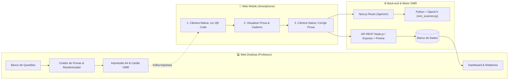

# 📘 Documentação Técnica — SGP / Correge

**Sistema de Geração, Randomização e Correção Automática de Provas via QR Code e Leitura Óptica (OMR)**  
*Centro Universitário Católica de Santa Catarina (Católica SC)*

---

## 📑 Sumário

1. [Visão Geral da Arquitetura](#1-visão-geral-da-arquitetura)
2. [Stack Tecnológica](#2-stack-tecnológica)
3. [Estrutura do Projeto](#3-estrutura-do-projeto)
4. [Arquitetura de Componentes e Fluxo de Dados](#4-arquitetura-de-componentes-e-fluxo-de-dados)
5. [Motor de Randomização e Geração de Cadernos (A4 / Duplex)](#5-motor-de-randomização-e-geração-de-cadernos-a4--duplex)
6. [Especificação do QR Code e Motor Óptico OMR (Python + OpenCV)](#6-especificação-do-qr-code-e-motor-óptico-omr-python--opencv)
7. [Contratos da API REST](#7-contratos-da-api-rest)
8. [Detecção Mobile vs. Modo de Impressão A4](#8-detecção-mobile-vs-modo-de-impressão-a4)
9. [Segurança e Conformidade com a LGPD](#9-segurança-e-conformidade-com-a-lgpd)
10. [Instalação e Execução do Ambiente](#10-instalação-e-execução-do-ambiente)

---

## 1. Visão Geral da Arquitetura

O **Correge (SGP)** é uma plataforma híbrida (Web Desktop para gestão e impressão + Web Mobile dedicada para escaneamento e correção por câmera) projetada para automatizar todo o ciclo de avaliações acadêmicas:

1. **Elaboração e Banco de Questões**: Cadastro estruturado de questões objetivas (`A`–`E`) e discursivas categorizadas por disciplina, nível de dificuldade e tags temáticas.
2. **Geração de Cadernos Múltiplos (Anti-Cola)**: Geração automática de múltiplas versões de prova (`Caderno A`, `Caderno B`, `Caderno C`, `Caderno D`, etc.) utilizando algoritmos de permutação (*Fisher-Yates* e *Rotação Cíclica*) para embaralhar a ordem das questões e das alternativas mantendo um gabarito oficial individualizado por versão.
3. **Diagramação A4 com Marcadores Fiduciais e QR Code**: Renderização de folhas de prova e cartões-resposta OMR prontos para impressão física (incluindo compensação automática de verso em branco para impressão *Duplex* frente e verso).
4. **Leitura de QR Code e Correção Óptica (OMR)**: Quando aberto em um smartphone, o sistema apresenta exclusivamente a interface de leitura por câmera nativa:
   - **Etapa 1**: Abre a câmera nativa do celular, lê o QR Code da prova/cartão-resposta e identifica o exame, o caderno (`A`–`D`) e o estudante.
   - **Etapa 2**: Exibe a prova completa na tela do celular e permite acionar a câmera nativa para fotografar as marcações feitas à caneta pelo estudante.
   - **Etapa 3**: O motor óptico em **Python + OpenCV** (com suporte a análise óptica em `<canvas>`) detecta as bolhas preenchidas (`respostasLidas`), confronta com o gabarito oficial do caderno, calcula a nota e sincroniza o resultado com o back-end.



---

## 2. Stack Tecnológica

| Camada | Tecnologias |
|---|---|
| **Front-end Web & Mobile** | Next.js 16 (App Router), React 19, TypeScript, Tailwind CSS 4, Lucide Icons |
| **Leitura de QR Code & OMR** | Python 3.13, OpenCV (`opencv-python-headless`), NumPy, Pillow, `jsqr`, `BarcodeDetector API`, `qrcode` |
| **Back-end API REST** | Node.js, Express, TypeScript, Prisma ORM, PDFKit (`C:\Users\davi3\back-end`) |
| **Persistência & Sincronização** | PostgreSQL / MySQL (via Prisma ORM) + Cache Resiliente `localStorage` |

---

## 3. Estrutura do Projeto

```text
front-end/
├── app/                              # Rotas Next.js App Router
│   ├── api/omr/route.ts              # Bridge Node.js -> Python OpenCV (omr_scanner.py)
│   ├── alunos/page.tsx               # Gestão de estudantes
│   ├── banco-questoes/page.tsx       # Banco de questões
│   ├── cadastro/page.tsx             # Criação de conta institucional
│   ├── configuracoes/page.tsx        # Configurações e LGPD
│   ├── portal-aluno/page.tsx         # Portal de consulta de notas do estudante
│   ├── provas/                       # Listagem, criação (/new) e visualização (/[id])
│   ├── recuperar-senha/page.tsx      # Recuperação de senha em 3 etapas
│   ├── resultados/page.tsx           # Relatórios estatísticos e matriz de acertos
│   ├── turmas/page.tsx               # Gestão de turmas e disciplinas
│   ├── globals.css                   # Estilos globais e regras @media print A4
│   └── layout.tsx                    # Root Layout e provedor global
├── back-end/                         # Motor Python OpenCV integrado
│   ├── omr_scanner.py                # Leitor óptico de QR Code e bolhas OMR via OpenCV
│   └── server.py                     # Servidor HTTP Python standalone opcional (porta 5000)
├── components/
│   ├── auth/                         # LoginScreen, RegisterScreen, PasswordRecoveryScreen
│   ├── common/                       # A4ExamSheet, A4AnswerSheet, QrCodeGraphic, CorregeLogo
│   ├── layout/                       # AppShell (detecção Desktop/Mobile/Print), Header, Sidebar
│   ├── modals/                       # NewQuestionModal, NewStudentModal, ExcelImportModal
│   └── screens/                      # Telas principais + MobileScannerScreen
├── context/
│   └── AppContext.tsx                # Estado global, autenticação, geração de versões e sync API
├── docs/                             # Documentação técnica, manual do usuário e diagramas UML
└── lib/
    ├── api.ts                        # Cliente HTTP para a API REST e motor OMR
    ├── qrCode.ts                     # Gerador SVG ISO/IEC 18004 para QR Codes
    └── types.ts                      # Contratos TypeScript de todas as entidades
```

---

## 4. Arquitetura de Componentes e Fluxo de Dados

### 4.1 Gerenciamento de Estado (`AppContext.tsx`)
O [`AppProvider`](file:///C:/Users/davi3/front-end/context/AppContext.tsx#L240) centraliza:
- **Autenticação e Perfis (`professor` | `estudante`)**: Login institucional (`@catolicasc.org.br` para docentes e `@catolicasc.edu.br` para estudantes), cadastro de novas contas (`registerAccount`) e redefinição de senha por código de verificação (`requestPasswordReset` / `resetPassword`).
- **Sincronização com o Back-end (`syncWithBackend`)**: Verifica a conectividade com `API_BASE_URL` (`/api/v1/health`) e carrega disciplinas, turmas, alunos, provas e correções.
- **Geração de Cadernos (`buildExamVersions`)**: Cria automaticamente as versões `A`, `B`, `C`, `D`... embaralhando questões e alternativas e montando o mapa `answerKey: Record<number, 'A'|'B'|'C'|'D'|'E'>` específico de cada versão.

---

## 5. Motor de Randomização e Geração de Cadernos (A4 / Duplex)

### 5.1 Permutação de Questões e Alternativas
Para cada versão além do `Caderno A` (ou para todas as versões geradas):
1. As questões selecionadas são permutadas via algoritmo **Fisher-Yates**.
2. O texto da alternativa originalmente correta é rastreado antes do embaralhamento das opções `(A)` a `(E)`.
3. Após embaralhar os textos das alternativas, a nova letra onde o texto correto foi posicionado passa a ser o gabarito oficial (`correctAlternative`) daquela questão naquele caderno específico.

### 5.2 Impressão Frente e Verso (Duplex)
Nos componentes [`A4ExamSheet.tsx`](file:///C:/Users/davi3/front-end/components/common/A4ExamSheet.tsx) e [`A4AnswerSheet.tsx`](file:///C:/Users/davi3/front-end/components/common/A4AnswerSheet.tsx):
- Cada página possui **4 marcadores fiduciais pretos** nos cantos da folha para alinhamento óptico de perspectiva.
- Quando o modo **Frente e Verso (Duplex)** está ativo, o componente `A4BlankVersoSheet` insere automaticamente uma página em branco de compensação quando o caderno de questões termina em página ímpar, garantindo que o **Cartão-Resposta (OMR)** seja sempre impresso em uma folha física separada para destacamento.

---

## 6. Especificação do QR Code e Motor Óptico OMR (Python + OpenCV)

### 6.1 Formatos de Payload do QR Code Suportados
O leitor óptico é retrocompatível com todos os formatos de QR Code gerados pelo front-end e pelo back-end:

1. **Cabeçalho da Prova ([`A4ExamSheet.tsx`](file:///C:/Users/davi3/front-end/components/common/A4ExamSheet.tsx))**:
   ```json
   {
     "app": "CORREGE",
     "code": "#CAT-DIR-2026.1",
     "ver": "A",
     "nominal": true,
     "std": "2024.1.001",
     "pg": 1
   }
   ```
2. **Cartão-Resposta OMR ([`A4AnswerSheet.tsx`](file:///C:/Users/davi3/front-end/components/common/A4AnswerSheet.tsx))**:
   ```json
   {
     "app": "CORREGE",
     "exam": "CATDIR20261",
     "ver": "A",
     "nominal": true,
     "std": "2024.1.001",
     "q": 10
   }
   ```
3. **Serviço Assinado do Back-end (`QrCodeService.ts`)**:
   ```json
   {
     "appId": "CORREGE-V1",
     "vId": "uuid-versao",
     "ver": "A",
     "code": "#DIR-101",
     "stdId": "uuid-aluno",
     "reg": "2024.1.001",
     "ts": 1710000000,
     "chk": "a1b2c3d4"
   }
   ```

### 6.2 Pipeline de Processamento Óptico ([`back-end/omr_scanner.py`](file:///C:/Users/davi3/front-end/back-end/omr_scanner.py))
1. **Decodificação do QR Code (`detect_qr_code` & `decodeQrFromCanvas`)**:
   - No cliente: utiliza `BarcodeDetector` nativo do sistema operacional móvel combinado com `jsQR` em múltiplos recortes (quadro completo, centro e canto superior direito da folha A4).
   - No servidor Python: utiliza `cv2.QRCodeDetector` com equalização de histograma adaptativa (`CLAHE`) e limiarização de Otsu.
2. **Normalização de Iluminação Imune a Sombras (`compute_ink_maps`)**:
   - Estima o fundo branco local do papel com filtro Gaussiano largo (`81x81`) e subtrai a imagem em tons de cinza (`cv2.subtract(bg, norm_gray)`).
   - Elimina sombras projetadas pelo celular sobre a folha sem esvaziar o interior de bolhas totalmente preenchidas à caneta.
3. **Detecção e Reconstrução das 5 Alternativas por Questão (`find_bubble_candidates` & `extract_5_slots_from_cluster`)**:
   - Combina detecção de contornos circulares (`cv2.findContours`) e Transformada de Hough (`cv2.HoughCircles`).
   - Agrupa as bolhas por linha e coluna e reconstrói geometricamente as 5 posições equidistantes (`A`, `B`, `C`, `D`, `E`), mesmo que uma marcação forte à caneta ultrapasse a borda de uma das bolhas.
4. **Cálculo de Nota (`grade_exam`)**:
   - Confronta estritamente as respostas detectadas (`respostasLidas`) com o `officialAnswerKey` da versão lida. Questões em branco permanecem como `null` (`0` pontos).

---

## 7. Contratos da API REST

### 7.1 Endpoint Local do Motor OMR (`POST /api/omr`)
- **Action `"scan"`**:
  - **Request**:
    ```json
    {
      "action": "scan",
      "imageBase64": "data:image/jpeg;base64,...",
      "totalQuestions": 4,
      "officialAnswerKey": { "1": "B", "2": "B", "3": "B", "4": "B" },
      "versionLetter": "A",
      "maxScore": 10.0
    }
    ```
  - **Response**:
    ```json
    {
      "success": true,
      "engine": "python-opencv-omr",
      "qrDetected": true,
      "versionLetter": "A",
      "versaoMarcada": "A",
      "markedAnswers": { "1": "B", "2": "A", "3": "B", "4": "B" },
      "respostasLidas": { "1": "B", "2": "A", "3": "B", "4": "B" },
      "grading": {
        "correctCount": 3,
        "totalQuestions": 4,
        "totalScore": 7.5,
        "maxScore": 10.0,
        "details": [...]
      }
    }
    ```

### 7.2 Principais Rotas do Back-end (`/api/v1`)
| Método | Rota | Descrição |
|---|---|---|
| `GET` | `/api/v1/health` | Status de saúde da API e conexão com banco |
| `POST` | `/api/v1/professores` | Cadastro de novo professor |
| `GET` / `POST` | `/api/v1/disciplinas` | Listagem e criação de disciplinas |
| `GET` / `POST` | `/api/v1/turmas` | Listagem e criação de turmas |
| `GET` / `POST` | `/api/v1/students` | Listagem e cadastro de alunos (`/batch` para lote) |
| `GET` / `POST` | `/api/v1/questions` | Banco de questões |
| `GET` | `/api/v1/exams` | Listagem de provas e suas versões (`versions`) |
| `GET` | `/api/v1/exams/:id/layout?versionLetter=A` | Retorna o layout paginado e `answerKey` do caderno |
| `POST` | `/api/v1/qr-codes/validate` | Valida a integridade criptográfica (`chk`) do QR Code |
| `GET` / `POST` | `/api/v1/correcoes` | Lista ou persiste uma correção realizada (`respostasLidas`, `notaTotal`) |
| `PATCH` | `/api/v1/correcoes/:id/assign-student` | Vincula manualmente um aluno a uma folha avulsa corrigida |

---

## 8. Detecção Mobile vs. Modo de Impressão A4

O componente [`AppShell.tsx`](file:///C:/Users/davi3/front-end/components/layout/AppShell.tsx) gerencia a exibição responsiva:
- Em **Smartphones** (User-Agent móvel ou largura `< 768px`), renderiza exclusivamente o [`MobileScannerScreen.tsx`](file:///C:/Users/davi3/front-end/components/screens/MobileScannerScreen.tsx).
- Durante a **Impressão (`window.print()` / `@media print`)**, o navegador reduz a largura da página para o tamanho do papel A4 (`< 768px`). Para impedir que a interface mobile apareça na folha impressa:
  1. [`AppShell.tsx`](file:///C:/Users/davi3/front-end/components/layout/AppShell.tsx) escuta os eventos `beforeprint` e `afterprint` (`matchMedia('print')`) e bloqueia a troca para o layout mobile.
  2. [`app/globals.css`](file:///C:/Users/davi3/front-end/app/globals.css) aplica `.mobile-scanner-container { display: none !important; }` e `.desktop-print-container { display: block !important; }` dentro de `@media print`.

---

## 9. Segurança e Conformidade com a LGPD

- **Domínios Institucionais**: Validação estrita de e-mails `@catolicasc.org.br` (docentes) e `@catolicasc.edu.br` (estudantes).
- **Direito ao Esquecimento / Anonimização (LGPD)**: Na tela de Configurações (`/configuracoes`), o usuário pode acionar a **Anonimização de Dados Pessoais**, que substitui o nome completo e e-mail por identificadores anônimos preservando a integridade estatística das avaliações e notas acadêmicas.

---

## 10. Instalação e Execução do Ambiente

### 10.1 Pré-requisitos
- **Node.js** 18+ e `npm`
- **Python** 3.10+ com pacotes `opencv-python-headless`, `numpy` e `pillow`:
  ```bash
  pip install opencv-python-headless numpy pillow
  ```

### 10.2 Executando o Front-end + Motor OMR
```bash
# 1. Instalar dependências Node.js
npm install

# 2. Iniciar o servidor de desenvolvimento Next.js (porta 3000)
npm run dev
```

### 10.3 Variáveis de Ambiente (`.env.local`)
```env
NEXT_PUBLIC_API_URL=http://localhost:3333/api/v1
PYTHON_PATH=C:\Users\davi3\AppData\Local\Programs\Python\Python313\python.exe
```
