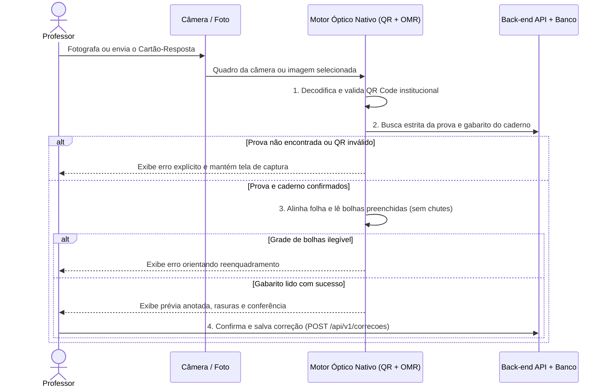

# Manual do Usuário — Sistema Correge (SGP Católica SC)

Bem-vindo ao **Manual do Usuário do Correge**, o Sistema de Geração, Randomização e Correção Automática de Provas do Centro Universitário Católica de Santa Catarina.

---

## Índice Rápido

1. [Acesso Docente, Cadastro e Segurança](#1-acesso-docente-cadastro-e-segurança)
2. [Gestão de Disciplinas, Turmas e Alunos (Excel/CSV)](#2-gestão-de-disciplinas-turmas-e-alunos-excelcsv)
3. [Banco de Questões (Objetivas e Discursivas)](#3-banco-de-questões-objetivas-e-discursivas)
4. [Criando uma Prova e Gerando Cadernos Embaralhados (A–Z)](#4-criando-uma-prova-e-gerando-cadernos-embaralhados-az)
5. [Pré-Visualização, Cartão-Resposta OMR e Impressão A4](#5-pré-visualização-cartão-resposta-omr-e-impressão-a4)
6. [Corrigindo Provas pelo Leitor Óptico (Desktop e Smartphone)](#6-corrigindo-provas-pelo-leitor-óptico-desktop-e-smartphone)
7. [Resultados, Estatísticas, Exportação e Folhas Avulsas](#7-resultados-estatísticas-exportação-e-folhas-avulsas)
8. [Configurações, Alteração de Senha e Privacidade (LGPD)](#8-configurações-alteração-de-senha-e-privacidade-lgpd)
9. [Perguntas Frequentes e Solução de Problemas (FAQ)](#9-perguntas-frequentes-e-solução-de-problemas-faq)

---

## 1. Acesso Docente, Cadastro e Segurança

### 1.1 Criando sua Conta Docente (Primeiro Acesso)
1. Na tela inicial de login, clique em **Criar Conta Docente** (ou acesse `/cadastro`).
2. Informe:
   - **Nome Completo** (nome e sobrenome);
   - **E-mail Institucional** obrigatório no domínio `@catolicasc.org.br`;
   - **Curso / Departamento Principal**;
   - **Senha de Acesso** (mínimo de 8 caracteres) e confirmação;
   - Aceite dos **Termos de Uso e Política de Privacidade (LGPD)**.
3. Clique em **Criar Conta e Acessar Painel**. Sua conta é gravada no banco de dados com senha criptografada (`bcrypt`) e você entra autenticado automaticamente.

### 1.2 Fazendo Login
1. Informe seu **E-mail Institucional (`@catolicasc.org.br`)** e sua **Senha** cadastrada.
2. Clique em **Entrar no Painel do Docente**.
3. Sua sessão autenticada via JWT permanece ativa mesmo ao recarregar a página, sendo validada automaticamente junto ao servidor. Para encerrar a sessão, abra o menu do seu perfil no canto superior direito e clique em **Sair da Conta (Logout)**.

### 1.3 Recuperação de Senha
1. Na tela de login, clique em **Esqueceu a senha?** (`/recuperar-senha`).
2. Informe seu e-mail `@catolicasc.org.br` para solicitar o token criptográfico de redefinição (quando o envio SMTP institucional estiver habilitado no servidor) e defina sua nova senha.
3. Caso já esteja logado e deseje trocar a senha, utilize a seção **Segurança e Senha de Acesso** em **Configurações** (`/configuracoes`).

---

## 2. Gestão de Disciplinas, Turmas e Alunos (Excel/CSV)

### 2.1 Disciplinas e Turmas
1. Acesse **Turmas** (`/turmas`) ou **Disciplinas** (`/disciplinas`) no menu lateral.
2. Cadastre as disciplinas informando nome, código e curso.
3. Crie turmas vinculadas à disciplina e período letivo (ex.: `2026.1`). Cada turma recebe um código de convite exclusivo que pode ser copiado ou regenerado.

### 2.2 Cadastrando Alunos Individualmente ou por Planilha
1. Acesse **Alunos** (`/alunos`).
2. **Cadastro Individual**: clique em **+ Novo Aluno**, preencha nome, matrícula, curso, e-mail e turma, e salve.
3. **Importação em Lote (Excel / CSV)**: clique em **Importar Excel**, baixe o modelo oficial se desejar e envie sua planilha contendo nome e matrícula dos estudantes. Os registros são gravados diretamente no banco de dados.

---

## 3. Banco de Questões (Objetivas e Discursivas)

1. Acesse **Banco de Questões** (`/banco-questoes`).
2. Utilize a busca ou filtros por **Dificuldade** (*Fácil*, *Médio*, *Difícil*) e **Etiquetas** cadastradas.
3. Clique em **+ Nova Questão**:
   - Escolha o tipo (**Objetiva** ou **Discursiva**), disciplina, dificuldade e etiquetas;
   - Digite o enunciado;
   - Para questões objetivas, preencha as alternativas (`A` a `E`) e selecione qual é a **Alternativa Correta (Gabarito)**;
   - Opcionalmente informe o comentário/fundamentação para o gabarito pós-prova.
4. Ao excluir uma questão, é aplicado *soft-delete*: ela deixa de aparecer em novas provas sem comprometer o histórico de avaliações anteriores.

---

## 4. Criando uma Prova e Gerando Cadernos Embaralhados (A–Z)

1. Acesse **Provas** (`/provas`) e clique em **+ Nova Prova** (`/provas/new`).
2. **Etapa 1 — Dados Gerais**: preencha título, disciplina, curso, turma, data, duração, nota máxima e instruções.
3. **Etapa 2 — Seleção de Questões**: selecione até **20 questões** do banco.
4. **Etapa 3 — Randomização e Identificação**:
   - **Quantidade de Cadernos**: defina quantas versões deseja gerar (de `1` a `26`, identificadas de `A` até `Z`);
   - **Embaralhar Questões** e **Embaralhar Alternativas**: gera permutações únicas por caderno recalculando automaticamente o gabarito oficial de cada versão;
   - **Identificação Nominal**: ativa impressão personalizada com nome/matrícula no cabeçalho e no QR Code de cada aluno (ou deixe desativado para folhas avulsas).
5. Salve a avaliação: a prova e seus cadernos são persistidos no banco de dados.

---

## 5. Pré-Visualização, Cartão-Resposta OMR e Impressão A4

Na lista **Provas** (`/provas`), clique em **Imprimir** (Caderno de Prova) ou **Folha OMR** (Cartão-Resposta):

- **Modo Frente e Verso (Duplex)**: insere verso em branco automático quando o caderno de questões termina em página ímpar, garantindo que o **Cartão-Resposta OMR** seja impresso em folha separada para entrega.
- **Elementos do Cartão-Resposta OMR**:
  - 4 marcadores fiduciais pretos nos cantos (com marcador assimétrico no topo esquerdo);
  - QR Code institucional no canto superior direito contendo o identificador único da prova, o caderno (`A`–`Z`) e os dados nominais/avulsos;
  - Grade de bolhas (`A`–`E`) organizada em 2, 3 ou 4 colunas conforme o total de questões.
- **Recomendação de impressão**: imprima em papel branco A4 com escala **100% (Tamanho Real)** e sem cabeçalhos/rodapés automáticos do navegador.

---

## 6. Corrigindo Provas pelo Leitor Óptico (Desktop e Smartphone)

O leitor óptico (OMR) funciona nativamente no navegador tanto no **Computador** (botão **Corrigir com Leitor** no topo ou na lista de provas) quanto no **Smartphone** (interface mobile automática ao acessar pelo celular).

### 6.1 Pelo Computador (Câmera ao Vivo ou Upload de Foto)
1. Clique em **Corrigir com Leitor**.
2. Escolha **Câmera ao Vivo** ou **Upload de Foto**.
3. Enquadre o cartão-resposta inteiro (com o **QR Code** e toda a **grade de bolhas** visíveis) e clique em **Capturar e Ler Gabarito** (ou selecione a foto do arquivo).
4. **Validação estrita**:
   - Se a foto não contiver QR Code do Correge ou se a prova não existir no sistema, será exibido um aviso claro de erro — o sistema nunca corrige usando outra prova.
   - Se o cartão-resposta estiver sem marcação em alguma questão, ela permanece **em branco (`—`)** (sem chutes).
   - Se o aluno marcar duas opções ou rasurar uma questão, o sistema destaca a questão em **âmbar** para decisão do professor.
5. Na tela de **Conferência**, inspecione a prévia óptica anotada (círculos verdes = lidas, âmbar = rasura), faça ajustes manuais se necessário, atribua as notas das questões discursivas (se houver) e clique em **Confirmar e Salvar Correção**.

### 6.2 Pelo Celular (Smartphone)
1. Acesse o sistema pelo navegador do celular e faça login com sua conta docente.
2. **Passo 1 — Ler QR Code**: toque em **Abrir Câmera e Ler QR Code** (ou **Selecionar Foto da Galeria**) e fotografe o QR Code / cartão-resposta da prova. O sistema valida a prova no banco de dados antes de abrir o caderno.
3. **Passo 2 — Ler Gabarito**: confira o caderno identificado e toque em **Abrir Câmera e Ler Gabarito** para fotografar a grade de bolhas preenchida pelo estudante. Caso haja rasuras ou questões discursivas, revise-as antes de confirmar.
4. **Passo 3 — Corrigida**: visualize a nota final, o total de acertos/erros/brancos e o gabarito comentado questão por questão. Toque em **Escanear Próxima Prova** para continuar o lote.

---

## 7. Resultados, Estatísticas, Exportação e Folhas Avulsas

Acesse **Resultados** (`/resultados`) no computador para visualizar:
- **Indicadores Estatísticos**: média da turma, mediana, desvio padrão, maior/menor nota e taxa de aprovação;
- **Análise por Questão**: percentual de acertos e distribuição dos distratores (`A`–`E` e em branco);
- **Exportações Reais**: baixe a planilha completa em **Excel (`.xlsx`)** ou o relatório consolidado em **PDF**;
- **Folhas Avulsas (Sem Identificação Nominal)**: correções salvas sem aluno vinculado ficam pendentes de atribuição e podem ser associadas ao estudante correto a qualquer momento.

---

## 8. Configurações, Alteração de Senha e Privacidade (LGPD)

Em **Configurações** (`/configuracoes`):
- **Dados Institucionais e Parâmetros OMR**: edite nome da instituição, departamento, nota mínima de aprovação e sensibilidade OMR (salvos diretamente no banco de dados) ou restaure os padrões.
- **Segurança e Senha de Acesso**: altere sua senha informando a senha atual e a nova senha (mín. 8 caracteres).
- **Anonimização de Conta (LGPD)**: permite anonimizar irreversivelmente seus dados pessoais (nome e e-mail) encerrando o acesso à conta, preservando as provas e o histórico acadêmico da instituição.

---

## 9. Perguntas Frequentes e Solução de Problemas (FAQ)

| Situação | O que fazer |
|---|---|
| **Mensagem "Prova não encontrada no sistema para o QR Code lido"** | Verifique se o QR Code pertence a uma avaliação criada e sincronizada no sistema (clique em **Atualizar** na lista de Provas) e evite fotografar QR Codes externos. |
| **Mensagem "Grade do gabarito incompleta ou não identificada"** | Fotografe o cartão-resposta inteiro em local bem iluminado, evitando reflexos fortes, sombras muito inclinadas ou cortes nas colunas de bolhas. Oriente os alunos a preencher completamente a bolha com caneta esferográfica **preta ou azul**. |
| **Questão destacada em âmbar ("Rasura / Dupla Marcação")** | O leitor detectou tinta significativa em duas ou mais bolhas na mesma questão e deixou a resposta sem marcação automática. Confira a folha física na prévia e clique na alternativa correta ou mantenha em branco. |
| **Erro ao fazer login** | Confira se o e-mail termina com `@catolicasc.org.br` e se a conta já foi criada na tela **Criar Conta Docente**. |
| **Impressão A4 saindo cortada ou com margens extras** | Na janela de impressão do navegador, selecione papel **A4**, escala **100% (Tamanho Real)** e desmarque **Cabeçalhos e rodapés**. |
