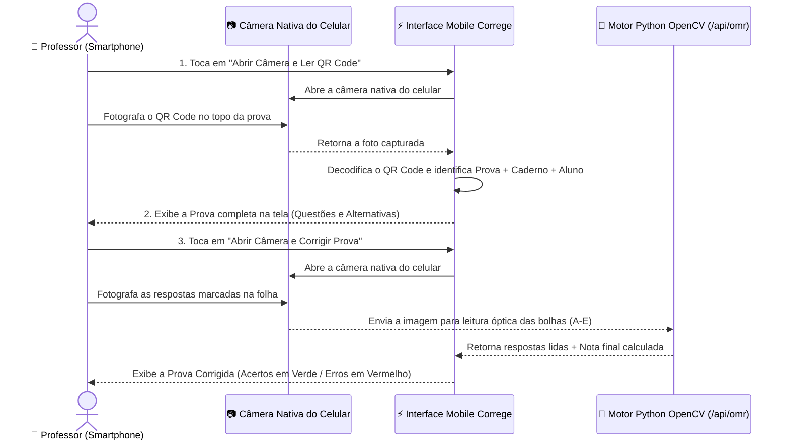

# 📖 Manual do Usuário — Sistema Correge (SGP Católica SC)

Bem-vindo ao **Manual do Usuário do Correge**, o Sistema de Geração, Randomização e Correção Automática de Provas do Centro Universitário Católica de Santa Catarina.

---

## 📑 Índice Rápido

1. [Acesso ao Sistema, Criação de Conta e Recuperação de Senha](#1-acesso-ao-sistema-criação-de-conta-e-recuperação-de-senha)
2. [Gestão de Turmas e Alunos (Importação via Excel)](#2-gestão-de-turmas-e-alunos-importação-via-excel)
3. [Banco de Questões (Objetivas e Discursivas)](#3-banco-de-questões-objetivas-e-discursivas)
4. [Criando uma Prova e Gerando Cadernos Embaralhados (A, B, C, D)](#4-criando-uma-prova-e-gerando-cadernos-embaralhados-a-b-c-d)
5. [Pré-Visualização, Cartão-Resposta OMR e Impressão Física](#5-pré-visualização-cartão-resposta-omr-e-impressão-física)
6. [Como Escanear e Corrigir Provas pelo Celular (Smartphone)](#6-como-escanear-e-corrigir-provas-pelo-celular-smartphone)
7. [Resultados, Estatísticas e Lançamento Manual](#7-resultados-estatísticas-e-lançamento-manual)
8. [Portal do Aluno](#8-portal-do-aluno)
9. [Perguntas Frequentes e Solução de Problemas (FAQ)](#9-perguntas-frequentes-e-solução-de-problemas-faq)

---

## 1. Acesso ao Sistema, Criação de Conta e Recuperação de Senha

### 1.1 Fazendo Login
1. Acesse a página inicial do sistema.
2. Escolha o seu perfil no topo do cartão de login:
   - **Sou Professor (`@catolicasc.org.br`)**: Acesso completo para criar questões, gerar provas, imprimir folhas de resposta e corrigir avaliações.
   - **Sou Estudante (`@catolicasc.edu.br`)**: Acesso ao Portal do Aluno para consultar notas e gabaritos publicados.
3. Digite seu **E-mail Institucional** e sua **Senha** e clique em **Entrar**.

### 1.2 Criando uma Nova Conta Docente
1. Na tela de login, clique em **Criar Conta Institucional** (ou acesse `/cadastro`).
2. Preencha os campos obrigatórios:
   - **Nome Completo**
   - **Departamento / Escola** (ex.: *Escola de Direito | Ciências Jurídicas*)
   - **E-mail Institucional** (deve terminar com `@catolicasc.org.br`)
   - **Senha de Acesso** (mínimo de 8 caracteres, contendo letras maiúsculas e números) e **Confirmação de Senha**
3. Marque o aceite do **Termo de Consentimento LGPD** e clique em **Criar Conta e Acessar Painel**.

### 1.3 Recuperando sua Senha
1. Na tela de login, clique em **Esqueceu a senha?** (ou acesse `/recuperar-senha`).
2. **Passo 1 (E-mail)**: Informe seu e-mail institucional (`@catolicasc.org.br` ou `@catolicasc.edu.br`) e clique em **Enviar Código de Verificação**.
3. **Passo 2 (Código de 6 Dígitos)**: Digite o código numérico de 6 dígitos enviado para o seu e-mail.
4. **Passo 3 (Nova Senha)**: Defina sua nova senha (mínimo de 8 caracteres) e confirme para atualizar seu acesso imediatamente.

---

## 2. Gestão de Turmas e Alunos (Importação via Excel)

### 2.1 Criando e Gerenciando Turmas
1. No menu lateral (Computador), clique em **Turmas** (`/turmas`).
2. Para criar uma nova turma, informe o **Nome da Turma**, a **Disciplina** e o **Período Letivo** (ex.: `2026.1`).
3. Cada turma possui um **Código de Convite** único (ex.: `CAT-DIR-4821`) que pode ser compartilhado com os estudantes ou regenerado a qualquer momento.

### 2.2 Cadastrando Alunos Manualmente ou por Planilha Excel
1. No menu lateral, acesse **Alunos** (`/alunos`).
2. **Cadastro Individual**: Clique em **+ Novo Aluno**, preencha Nome, Matrícula, Curso, E-mail e Turma, e clique em **Salvar**.
3. **Importação em Lote (Excel / CSV)**:
   - Clique em **Importar Excel**.
   - Selecione a planilha contendo as colunas de **Nome** e **Matrícula** dos estudantes.
   - O sistema importará todos os alunos automaticamente e os distribuirá nos sorteios de cadernos das provas.

---

## 3. Banco de Questões (Objetivas e Discursivas)

1. No menu lateral, clique em **Banco de Questões** (`/banco-questoes`).
2. Utilize a barra de busca ou os filtros por **Disciplina** e **Dificuldade** (*Fácil*, *Médio*, *Difícil*) para localizar questões existentes.
3. Para cadastrar uma nova questão, clique em **+ Nova Questão**:
   - Escolha a **Disciplina**, o **Tópico/Conceito-Chave** e o **Nível de Dificuldade**.
   - Digite o **Enunciado** completo da questão.
   - Preencha as **5 Alternativas (`A`, `B`, `C`, `D`, `E`)** e marque qual delas é a **Alternativa Correta (Gabarito)**.
   - *(Opcional)* Preencha a **Explicação / Fundamentação Conceitual**, que poderá ser impressa no caderno pós-prova comentado.
   - Clique em **Salvar Questão**.

---

## 4. Criando uma Prova e Gerando Cadernos Embaralhados (A, B, C, D)

1. No menu lateral, clique em **Provas** (`/provas`) e depois em **+ Criar Nova Prova** (`/provas/new`).
2. **Etapa 1 — Dados Gerais da Avaliação**:
   - Informe o **Título da Prova** (ex.: *P1 - Direito Constitucional I*), **Disciplina**, **Curso**, **Turma**, **Data**, **Duração** e **Nota Máxima** (ex.: `10,0`).
   - Revise as **Instruções da Prova** que sairão impressas na capa.
3. **Etapa 2 — Seleção de Questões**:
   - Marque no Banco de Questões até **20 questões** para compor a avaliação.
4. **Etapa 3 — Configurações de Randomização e Identificação**:
   - **Quantidade de Cadernos (Versões)**: Escolha quantas versões diferentes deseja gerar (ex.: `4` cadernos: `A`, `B`, `C` e `D`).
   - **Embaralhar Ordem das Questões**: Altera a sequência das perguntas em cada caderno.
   - **Embaralhar Ordem das Alternativas**: Altera a posição das opções `(A)` a `(E)` dentro de cada questão, recalculando automaticamente o gabarito de cada caderno.
   - **Com Identificação Nominal do Aluno**: Gera uma prova e um cartão-resposta nominal para cada aluno da turma, já com o nome e matrícula preenchidos no cabeçalho e no QR Code.
5. Clique em **Finalizar e Gerar Prova**.

---

## 5. Pré-Visualização, Cartão-Resposta OMR e Impressão Física

Na lista de **Provas** (`/provas`), você pode abrir qualquer avaliação nos modos **Ver Caderno de Prova** ou **Folha de Respostas OMR**:

### 5.1 Caderno de Prova (`Pré-Visualização`)
- Alterne entre os **Cadernos A, B, C, D** ou visualize o **Lote Completo de Alunos**.
- **Frente e Verso (Duplex)**: Mantém ativada a compensação automática de verso em branco para que o Cartão-Resposta saia sempre em uma folha separada ao imprimir frente e verso.
- **Mostrar Gabarito / Explicação Conceitual**: Exibe as respostas corretas destacadas em verde para conferência do professor.
- Clique em **Imprimir Prova (A4)** para abrir a janela de impressão do navegador/sistema.

### 5.2 Cartão-Resposta Oficial (OMR)
- Contém:
  - **Cabeçalho Institucional** com código da prova e identificação do **Caderno (`A`, `B`, `C`, `D`)**.
  - **QR Code de Alta Precisão** no canto superior direito (com zona de silêncio livre de sobreposições).
  - **4 Marcadores Fiduciais Pretos** nos cantos da folha A4.
  - **Grade de Bolhas (`A` a `E`)** numeradas para preenchimento com caneta esferográfica preta ou azul.

---

## 6. Como Escanear e Corrigir Provas pelo Celular (Smartphone)

Quando você acessa o sistema pelo **navegador do seu smartphone** (Android ou iPhone), o Correge exibe automaticamente uma interface exclusiva e simplificada de **Leitor e Corretor OMR** dividida em **3 passos**:

### Passo a Passo no Celular:
1. **Passo 1 — Ler QR Code**:
   - Toque no botão vermelho **"Abrir Câmera e Ler QR Code"**.
   - A **câmera nativa do seu celular** será aberta.
   - Tire uma foto do **QR Code** localizado no canto superior direito da prova ou do cartão-resposta e confirme a foto.
2. **Passo 2 — Ver Prova**:
   - O sistema exibirá imediatamente na tela do celular a prova correspondente ao QR Code lido (**Título da Prova**, **Caderno A/B/C/D**, **Estudante** e todas as **Questões e Alternativas** daquele caderno).
   - Se a primeira foto já enquadrou as bolhas de resposta, as marcações detectadas já aparecerão destacadas. Você também pode tocar em qualquer alternativa na tela caso queira ajustar manualmente uma questão.
3. **Passo 3 — Corrigir Prova pela Câmera**:
   - Toque no botão vermelho **"Abrir Câmera e Corrigir Prova"**.
   - A **câmera nativa do celular** será aberta novamente.
   - Fotografe a grade de respostas preenchida pelo aluno (com boa iluminação e enquadrando as bolhas de `A` a `E`).
   - Assim que você confirmar a foto, o sistema **detectará as marcações opticamente e corrigirá a prova automaticamente**, exibindo:
     - **Nota Final Calculada** (ex.: `8.0/10`) e total de acertos;
     - **Detalhamento Questão por Questão**: indica em **Verde** as questões que o aluno acertou e em **Vermelho** as questões que errou ou deixou em branco, mostrando qual alternativa foi marcada e qual era o gabarito correto daquele caderno.
4. Para corrigir a prova do próximo aluno, basta tocar em **"Escanear Próxima Prova"**.

---

## 7. Resultados, Estatísticas e Lançamento Manual

No computador, acesse **Resultados** (`/resultados`) para acompanhar o desempenho consolidado da turma:
- **Indicadores Gerais**: Média da turma, mediana, desvio padrão, maior/menor nota e taxa de aprovação.
- **Análise por Questão**: Veja o percentual de acerto de cada questão e quais alternativas (distratores) foram mais assinaladas pelos alunos.
- **Lançamento Manual / Folhas Avulsas**: Caso tenha aplicado folhas de resposta sem identificação nominal no QR Code, acesse a aba de **Atribuição Manual** para vincular rapidamente a nota lida ao nome do estudante correspondente.

---

## 8. Portal do Aluno

Estudantes autenticados com e-mail `@catolicasc.edu.br` acessam o **Portal do Aluno** (`/portal-aluno`), onde podem:
- Visualizar suas notas individuais por avaliação realizada;
- Consultar o gabarito oficial e seu desempenho detalhado após a publicação pelo professor.

---

## 9. Perguntas Frequentes e Solução de Problemas (FAQ)

| Dúvida / Situação | Como Resolver |
|---|---|
| **Ao tentar imprimir no computador, aparecia a tela de celular.** | Já corrigido automaticamente! O sistema bloqueia o layout mobile durante a impressão (`@media print`), garantindo que apenas as páginas A4 da prova e do cartão-resposta sejam impressas. |
| **O QR Code não foi reconhecido na foto.** | Aproxime mais a câmera do celular do QR Code no canto superior direito da prova, mantendo o foco nítido e evitando reflexos de luz sobre o papel. |
| **Alguma bolha preenchida pelo aluno não foi detectada na foto.** | Oriente os alunos a preencherem totalmente o interior da bolha circular com caneta esferográfica **preta ou azul escuro**. Na tela de visualização da prova (Passo 2), o professor também pode tocar sobre qualquer alternativa para confirmar ou ajustar uma marcação antes de concluir. |
| **Como testar um novo sorteio de cadernos para os alunos?** | Na tela de **Pré-Visualização** ou **Folha de Respostas**, clique no botão **Sortear Cadernos** para redistribuir aleatoriamente as versões `A`, `B`, `C` e `D` entre os alunos da turma. |
