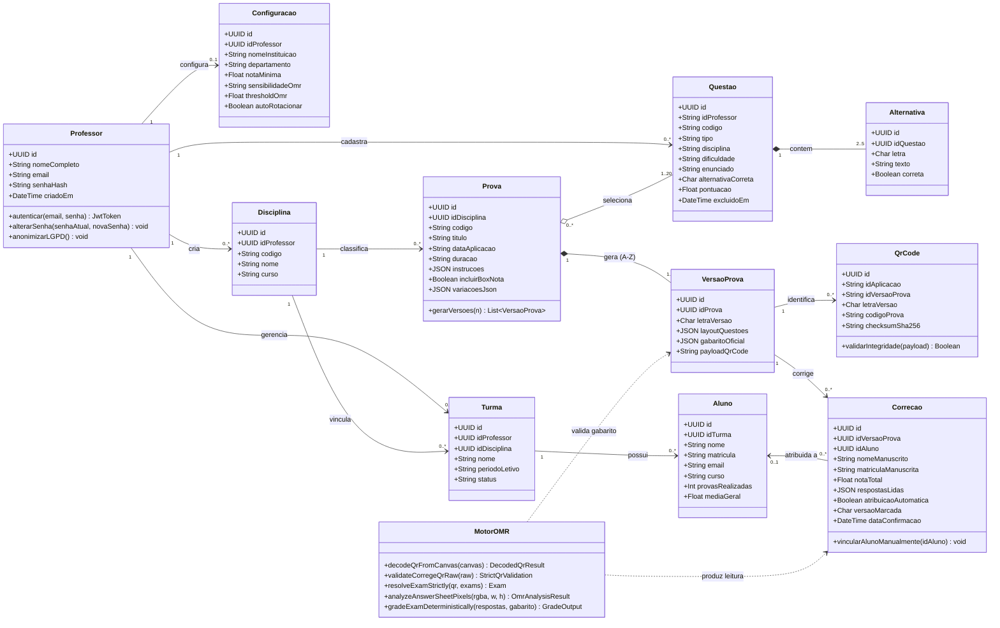

# Diagrama de Classes UML — SGP / Correge

Modelagem das entidades de domínio persistidas em MySQL/TiDB (`back-end/prisma/schema.prisma`) e do motor óptico OMR (`front-end/lib/omrEngine.ts` + `lib/omrScannerFlow.ts`).

