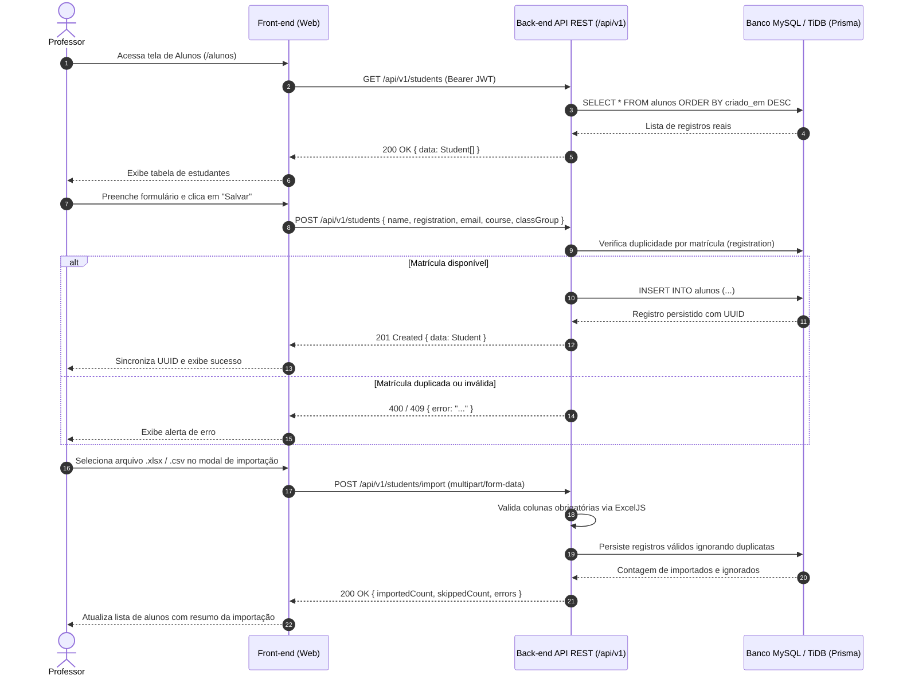

# Diagrama de Sequência — Gestão e Importação de Alunos

Cenários cobertos: listagem autenticada, cadastro individual com verificação de matrícula única e importação em lote via Excel/CSV (`/api/v1/students`).

