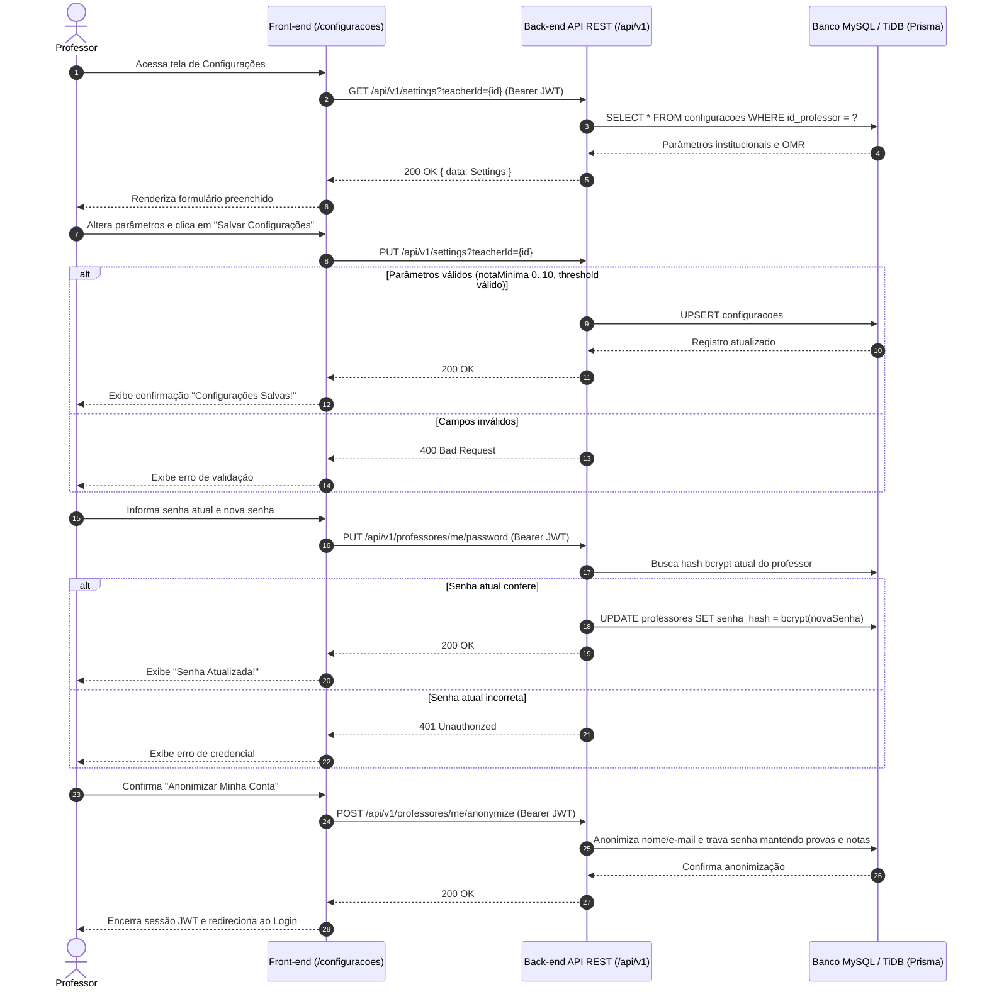

# Diagrama de Sequência — Configurações, Senha e Anonimização LGPD

Cenários cobertos: carregamento e salvamento de preferências institucionais/OMR (`/api/v1/settings`), alteração autenticada de senha (`PUT /api/v1/professores/me/password`) e anonimização irreversível conforme LGPD (`POST /api/v1/professores/me/anonymize`).

