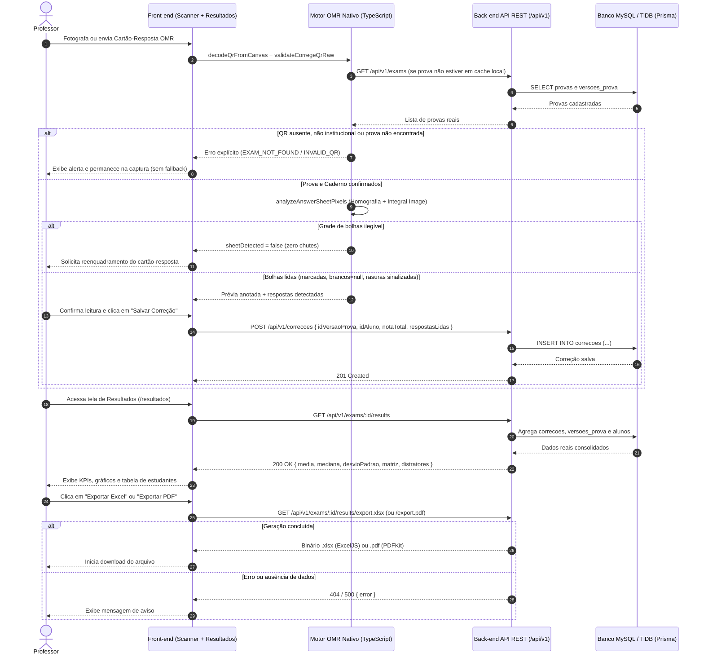

# Diagrama de Sequência — Correção OMR, Resultados e Exportação

Cenários cobertos: leitura óptica estrita (QR Code + OMR nativo sem chutes), persistência de correção (`POST /api/v1/correcoes`), consulta de estatísticas consolidadas (`GET /api/v1/exams/:id/results`) e exportação oficial em Excel/PDF.

